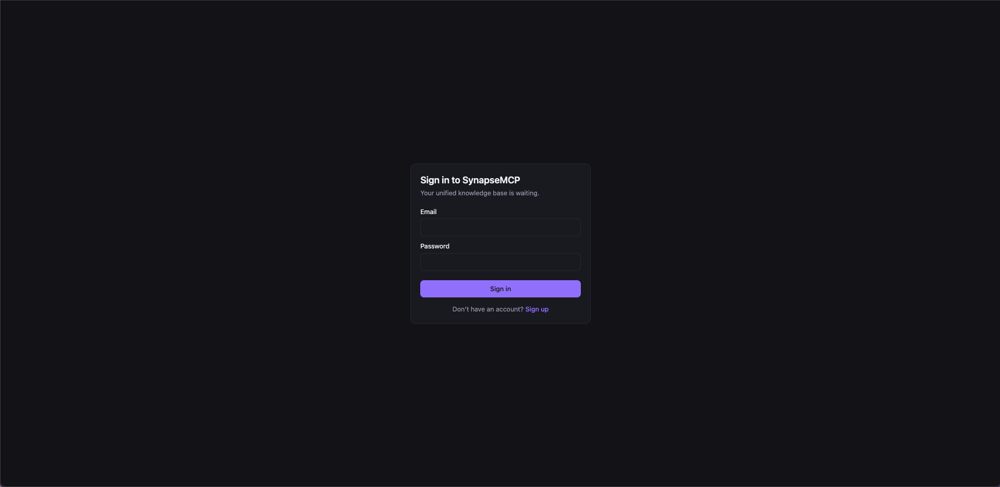

# SynapseMCP — Backend

A multi-tenant Retrieval-Augmented Generation (RAG) platform, built as a Spring Boot backend that doubles as a **Model Context Protocol (MCP) server**. Every user is a tenant with exactly **one** unified knowledge base: drop in documents, and both the web client *and* any MCP-speaking LLM (Claude Desktop, Cursor, etc.) can query them — isolated, cited, and with zero permanent file storage.

Java 21 (virtual threads) · Spring Boot 3.5 · Spring AI (Google Gemini) · PostgreSQL 17 + pgvector · AWS S3 (transient staging only)

Full specs live in [`docs/`](docs/): [`instruction.md`](docs/instruction.md) (requirements), [`architecture.md`](docs/architecture.md) (system design + DDL), [`design.md`](docs/design.md) (class/package design), [`plan.md`](docs/plan.md) (roadmap & milestones). Each one documents both the original spec and the as-built deviations.

---

## What it does

- **One account, one knowledge base.** Sign up and the backend auto-provisions a tenant and a single knowledge base — no multi-KB management, no org invites.
- **Upload almost any document.** PDF, Word, Excel, PowerPoint, HTML, text/CSV/Markdown/JSON, or images, up to 10 MB. Java parsers (PDFBox, POI, Jsoup, Tess4J/Tesseract OCR) run first; Gemini multimodal extraction is used as a fallback for files ≤ 2 MiB that the Java parsers can't handle.
- **Real-time ingestion progress.** Upload returns immediately (202), then a Server-Sent Events stream reports `QUEUED → PARSING → CHUNKING → EMBEDDING → PURGING_S3 → INDEXED` as a background worker (Java 21 virtual threads) processes the file.
- **Zero permanent file storage.** Uploaded files are staged in S3 only long enough to parse, chunk, and embed them. The instant the chunks and vectors are committed to PostgreSQL, the S3 object is deleted — `raw_file_purged = TRUE`, no re-download, ever.
- **Grounded chat with fallback.** Questions are answered from the tenant's own pgvector-indexed chunks (top-8, cosine similarity ≥ 0.70) with citations; below that threshold, it falls back to a web search, and failing that, returns an explicit "nothing found" response rather than guessing.
- **MCP server for external LLMs.** Generate a personal API key and point Claude Desktop, Cursor, or any MCP client at `/mcp/sse`. They get four tools: `search_user_knowledge_base`, `query_user_rag`, `get_ingestion_status`, and `upload_document` — all scoped to that tenant's isolated data.
- **Tenant isolation, defense in depth.** Every query is bound to `tenant_id` at the application layer *and* enforced again by PostgreSQL Row-Level Security.
- **Chat history stays client-side.** Conversations are never persisted server-side — the frontend holds them in session state and sends recent turns as context on each request.

---

## How it looks

The screens below are from the companion React frontend (lives in its own separate repository, not in this one), driving this backend purely over `/api/v1/**` and SSE.

**Sign up / sign in** — one account, one knowledge base, no setup screens:

<p align="center">
  
  &nbsp;&nbsp;
  
</p>

**Home workspace** — drag-and-drop upload on the left, chat on the right:

<p align="center">
  
</p>

**Upload & ingestion** — the dual-phase progress stepper tracks network upload, then live SSE ingestion stages, and the knowledge base table shows each document's category, chunk count, and `Indexed - S3 Purged` status:

<p align="center">
  
</p>

**RAG chat with citations** — answers cite the source document and similarity score:

<p align="center">
  
</p>

---

## Tech stack

| Layer | Technology |
|---|---|
| Runtime | Java 21 (virtual threads for async ingestion, SSE, API calls) |
| Framework | Spring Boot 3.5, Spring AI 1.1.7 (Google GenAI starters), Spring Data JPA, Spring Security (JWT + MCP API-key filters) |
| Database | PostgreSQL 17 + pgvector 0.8.3 — `vector(768)` HNSW cosine index, Row-Level Security, Flyway migrations |
| LLM | Google `gemini-3.5-flash-lite` (fixed, non-configurable) |
| Embeddings | Google `gemini-embedding-2`, 768 dimensions (fixed, non-configurable) |
| Document parsing | Apache PDFBox, Apache POI, Jsoup, Tess4J (Tesseract OCR, bundled English `tessdata`) |
| Web search fallback | DuckDuckGo Instant Answer API |
| Object storage | AWS S3 — transient staging only, purged immediately after embedding |
| MCP transport | Spring AI MCP Server starter (WebMVC/SSE) |

---

## Prerequisites

- JDK 21
- PostgreSQL 17 with the `pgvector` extension (0.8+)
- A Google Gemini API key
- An AWS S3 bucket and credentials (or a local S3-compatible endpoint such as LocalStack/MinIO for dev)

## Setup

1. Create the database and the non-owner application role: run [`docs/local-db-setup.sql`](docs/local-db-setup.sql).
2. Copy the environment variables below into your shell or IDE run configuration (the app does **not** load `.env` files itself).
3. Configure the S3 bucket: see [`docs/s3-setup.md`](docs/s3-setup.md).
4. Run — Flyway migrates the schema on startup using the `DB_MIGRATION_*` credentials:

```bash
./mvnw spring-boot:run        # Windows: mvnw.cmd spring-boot:run
./mvnw test
```

If `JAVA_HOME` isn't set, point it at your JDK 21 first.

### Environment variables

```bash
# --- Database ---
DB_URL=jdbc:postgresql://localhost:5432/synapsemcp
DB_USERNAME=synapse_app            # non-owner app role, so RLS applies
DB_PASSWORD=change-me
DB_MIGRATION_USERNAME=admin        # schema owner, used only for Flyway
DB_MIGRATION_PASSWORD=change-me

# --- Auth ---
JWT_SECRET=                        # base64-encoded, >= 32 bytes: openssl rand -base64 48

# --- Google Gemini (chat: gemini-3.5-flash-lite, embeddings: gemini-embedding-2 @ 768 dims) ---
GEMINI_API_KEY=                    # GOOGLE_API_KEY also works

# --- AWS S3 (transient staging only) ---
S3_BUCKET=aws-rag-bucket-app
AWS_REGION=us-east-1
AWS_ACCESS_KEY=                    # read explicitly; the AWS default provider chain is NOT used
AWS_SECRET_KEY=
S3_ENDPOINT=                       # blank = real AWS; set for LocalStack/MinIO (path-style)

# --- Optional ---
CORS_ALLOWED_ORIGINS=http://localhost:5173
```

---

## API

### REST (web client — JWT auth)

| Method | Path | Notes |
|---|---|---|
| POST | `/api/v1/auth/signup` | Creates user, tenant, and the tenant's single default knowledge base |
| POST | `/api/v1/auth/signin` | Returns a JWT |
| POST | `/api/v1/documents/upload` | `multipart/form-data`; 202 Accepted with `documentId`/`jobId`; 413 if over 10 MB |
| GET | `/api/v1/documents/{id}/progress-stream` | SSE: live `QUEUED → PARSING → CHUNKING → EMBEDDING → PURGING_S3 → INDEXED` |
| GET | `/api/v1/documents/{id}/status` | Point-in-time ingestion status (polling fallback) |
| GET | `/api/v1/documents` | List the tenant's documents |
| DELETE | `/api/v1/documents/{id}` | Deletes document + cascades its chunks |
| POST | `/api/v1/chat` | RAG query: local vector search → web fallback → synthesized answer with citations |
| POST / GET / DELETE | `/api/v1/keys/mcp` | Generate, list, revoke MCP API keys |

### MCP (external LLM clients — API-key auth)

SSE transport at `GET /mcp/sse`, JSON-RPC 2.0 messages at `POST /mcp/messages` — provided by the Spring AI MCP Server starter. Authenticate with `Authorization: Bearer <mcp_api_key>`. Four tools are registered, all scoped to the key's tenant:

| Tool | Does |
|---|---|
| `search_user_knowledge_base` | Semantic search returning matching chunks with similarity scores |
| `query_user_rag` | Full RAG pipeline — vector search, web fallback, synthesized answer |
| `get_ingestion_status` | Poll a document's ingestion progress |
| `upload_document` | Add a file (filename + Base64 content) to the knowledge base — reuses the same validation/parsing/chunking/embedding pipeline as the REST upload endpoint |

---

## Ingestion pipeline

Files are parsed Java-first, Gemini-fallback (reversed from the original size-tiered spec — see `docs/plan.md` §1.1 for the rationale):

- **Up to 2 MiB:** the Java parser runs first; if it fails or finds nothing, Gemini multimodal extraction is tried as a fallback. Both failing produces one combined error.
- **2 MiB – 10 MB:** Java parsers only, no Gemini fallback.
- **Over 10 MB:** rejected immediately with HTTP 413 `FILE_LIMIT_EXCEEDED`, before anything is read into memory.

### Java parsers (`ingestion/extraction/parser`)

| Category | Parser | Output |
|---|---|---|
| PDF | PDFBox | Text layer in reading order; pages with no embedded text (scanned, or an image dropped into a text PDF) are rendered and OCR'd per-page via Tesseract, so a mixed PDF only pays OCR cost where it's needed |
| Word `.doc`/`.docx` | POI | Headings by style, lists, tables as Markdown |
| Excel `.xls`/`.xlsx` | POI | One `## Sheet` section per sheet as a Markdown table; formulas evaluated, values as Excel displays them |
| PowerPoint `.ppt`/`.pptx` | POI | `## Slide N: title`, bullets, tables, speaker notes; a slide with no title and only decorative shapes is skipped rather than emitting an empty stub |
| HTML | Jsoup | Scripts/styles stripped; headings, lists, tables, `pre` preserved |
| Text `.txt`/`.csv`/`.md`/`.json` | direct | UTF-8 (BOM-aware, Windows-1252 fallback) |
| Images | Tess4J (Tesseract) | OCR, English only; `tessdata` bundled under `src/main/resources/tessdata`; mixed-contrast images are split into brightness bands, each OCR'd with the matching polarity |

Extracted text is split by a category-adaptive chunker (word-count target per category — e.g. one chunk per slide for PowerPoint, one chunk per OCR'd line for images) and embedded in batches via `gemini-embedding-2`.

Run the opt-in live Gemini tests with `GEMINI_API_KEY` set:

```bash
./mvnw test -Dtest='MultimodalExtractor*LiveIT,GeminiLiveIT'
```

---

## Query routing

1. Embed the query, search the tenant's pgvector chunks (top 8, HNSW cosine).
2. If at least one chunk scores ≥ 0.70, synthesize an answer from those chunks (`source: "LOCAL_KB"`, cited).
3. Otherwise, fall back to the DuckDuckGo Instant Answer API (`source: "WEB_SEARCH"`).
4. If that also returns nothing, respond deterministically: *"No relevant data found in your knowledge base, and fallback web search returned no matching results."* (`source: "NONE"`) — never a hallucinated guess.

Synthesis runs at `temperature(0.0)` for deterministic, strictly-grounded answers, with retrieved chunks grouped by source document so multi-chunk facts from the same file are connected correctly.

---

## Database

PostgreSQL 17 + pgvector, with `tenant_id` as a discriminator column on every tenant-scoped table and Row-Level Security policies enforcing it as defense-in-depth alongside application-level filtering. Full DDL, entity-relationship diagram, and the Row-Level Security policies are in [`docs/architecture.md`](docs/architecture.md) §4.

Key tables: `tenants`, `users`, `api_keys`, `knowledge_bases` (exactly one per tenant, enforced by a unique constraint), `documents`, `ingestion_jobs`, `chunks` (`vector(768)` + full-text `tsvector`), `audit_logs`.
