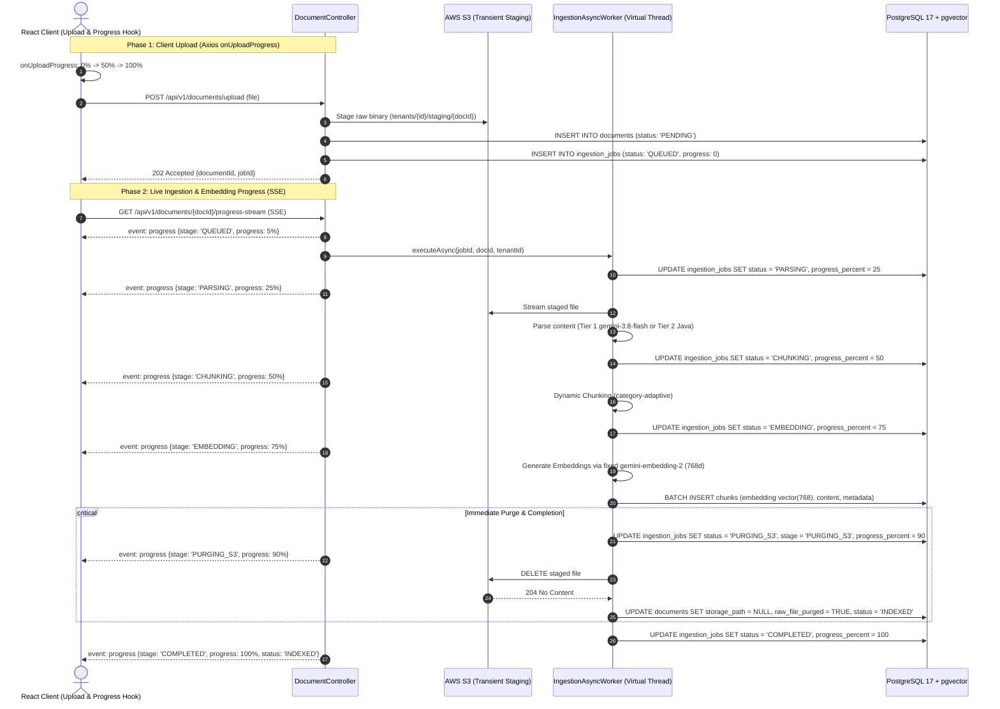
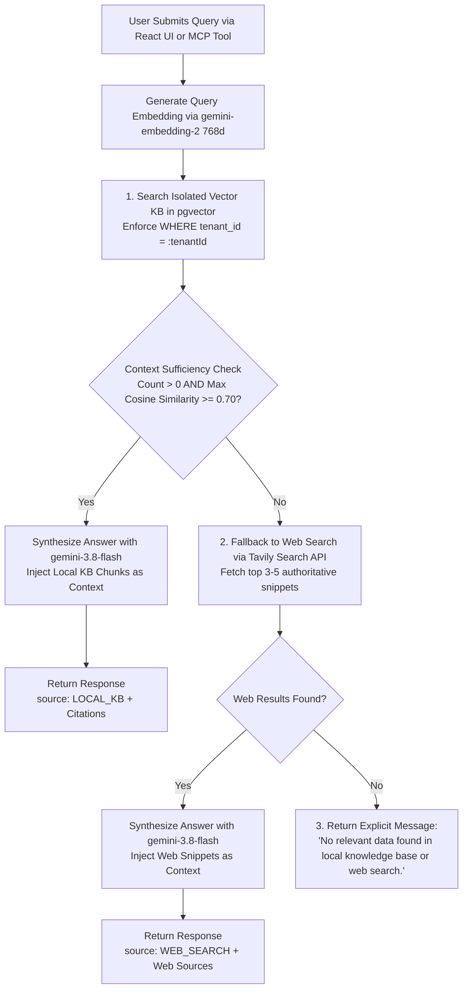

# Multi-Tenant RAG Application Specification & Technical Instructions

> **Document Type:** System Specification & Instructions (`instruction.md`)  
> **Role:** Senior Software Architect  
> **Target System:** Enterprise Multi-Tenant RAG Platform with Model Context Protocol (MCP) Server and React Client  
> **Date:** October 2026  
> **Status:** Final Architectural Baseline  

---

## 1. Project Overview & Role
- **Architect Role:** Senior Software Architect
- **Primary Task:** Design and architect a production-grade, multi-tenant Retrieval-Augmented Generation (RAG) platform with an integrated Model Context Protocol (MCP) server, Spring Boot backend, PostgreSQL + pgvector datastore, and React frontend.
- **Artifacts:**
  - `instruction.md`: Master architectural requirements, boundaries, storage lifecycle rules, dual-phase progress specifications, and technical directives.
  - `architecture.md`: High-level system architecture, component diagrams, asynchronous data pipelines with transient S3 staging, real-time SSE progress streaming, MCP layer topology, and complete PostgreSQL + pgvector DDL with Row-Level Security (RLS).
  - `design.md`: Low-level design, class/package structure, ingestion strategies, cleanup lifecycles, frontend dual-phase progress UI (`Upload -> Parse -> Chunk -> Embed -> Purged`), REST & MCP contracts.
  - `plan.md`: Phased execution roadmap, Work Breakdown Structure (WBS), milestone deliverables, risk mitigation, and Definition of Done (DoD).

---

## 2. Technology Stack

| Layer | Technology | Specification & Responsibilities |
|---|---|---|
| **Frontend** | React 19 + TypeScript + Vite | Primary web client: user authentication (Sign-up/Sign-in), unified KB document management, **dual-phase real-time progress tracking (network upload % + backend embedding stages)**, conversational RAG chat with source citations, transient session chat history, and MCP API key generation. |
| **Backend Framework** | Java 21 (LTS) + Spring Boot 3.3+ / 4.x | Core enterprise backend leveraging Virtual Threads (Project Loom), Spring Data JPA, Spring Security (Stateless JWT + API Key filters), and Spring AI. |
| **Persistence & Vectors** | PostgreSQL 17+ with `pgvector` | Unified relational store for tenants, users, documents, chunks, and ingestion jobs; vector store using pgvector HNSW cosine distance indexing (`vector(768)`). |
| **AI Model (LLM - Fixed)** | Google `gemini-3.8-flash` | Fixed backend model for multimodal extraction (<2MB), question routing, and answer synthesis. *Users cannot view, select, or modify the model.* |
| **AI Model (Embedding - Fixed)** | Google `gemini-embedding-2` | Fixed backend model with 768-dimensional vector output, stored in `chunks.embedding` (`vector(768)`). *Users cannot view, select, or modify the model.* |
| **External LLM Integration** | Model Context Protocol (MCP) Server | Spring Boot acts as an **MCP Server** (over HTTP/SSE transport). Authenticated users can generate an MCP API key to plug their private, isolated KB directly into external LLM environments (Claude Desktop, Cursor, external AI agents). |
| **Fallback Web Search** | Tavily Search API | High-accuracy search API invoked when local vector retrieval yields insufficient context (`cosine similarity < 0.70` or `0 chunks matched`). |
| **Storage Layer (Transient)** | Transient Staging (S3 / MinIO / Local FS) | **Zero Permanent S3 Storage:** S3/MinIO/Local disk is used strictly as a **temporary staging area** during ingestion. As soon as chunks and embeddings are stored in PostgreSQL, the staged file is **immediately deleted from S3**. |

---

## 3. Core Constraints & Business Rules

### 3.1 Authentication & Multi-Tenancy
- **Authentication Scope:** Users can only **Sign-up** and **Sign-in**. No complex tenant hierarchies, invites, or cross-tenant org structures.
- **Tenancy Model:** Each registered user represents an isolated tenant.
- **Data Isolation Strategy:** Row-Level Tenancy with a discriminator column (`tenant_id` / `user_id`) on all relational and vector tables, enforced via Spring Data JPA filters, Hibernate interceptors, and PostgreSQL Row-Level Security (RLS) policies.

### 3.2 Knowledge Base (KB) Constraint
- **Strictly ONE Unified KB per User:**
  - Upon user sign-up, the system automatically provisions exactly **ONE** single, unified Knowledge Base for that user.
  - All uploaded documents are automatically routed and indexed into this single unified KB.
  - Users **cannot** create, rename, switch, or delete multiple knowledge bases.
  - The UI presents a clean, unified document workspace rather than a knowledge base management portal.

### 3.3 Model Configuration Constraint
- **Fixed Backend AI Models (`gemini-3.8-flash` & `gemini-embedding-2`):**
  - Model selection is fixed in the backend configuration (`application.yml`).
  - Users have **no ability** to view, select, toggle, or modify LLM models or embedding models.
  - No model selection dropdowns or configuration screens exist in the React frontend.

### 3.4 Storage & Purge Constraint (Transient S3 Staging)
- **Zero Permanent Cloud Object Storage:**
  - Raw uploaded files must **NEVER be stored permanently** in AWS S3 or MinIO.
  - S3 / Local storage functions strictly as a temporary scratch/staging area while the asynchronous worker processes the document.
  - **Purge Rule:** Immediately after the document's text is parsed, split into chunks, embedded by `gemini-embedding-2`, and committed into PostgreSQL (`chunks` table), the backend executes a mandatory delete operation against S3 to permanently destroy the raw uploaded binary.
  - **No Raw File Re-Download:** Since raw binaries are permanently deleted from S3 for data privacy and zero storage costs, documents cannot be re-downloaded in their original format from the UI. Extracted text chunks remain permanently accessible and queryable via citation drawers.
  - **Database Representation:** The `documents` table retains document metadata (`name`, `file_size`, `content_type`, `created_at`, `status = 'INDEXED'`), with `storage_path = NULL` and `raw_file_purged = TRUE`.

### 3.5 Chat History Lifecycle
- **Transient in React:** Chat conversation history is held strictly in React client session state (`useRagChat`), ensuring user privacy and keeping PostgreSQL lean without conversational transcript retention.

### 3.6 Dual-Phase Frontend Progress Tracking Constraint
The React frontend **MUST** provide continuous, unbroken visual feedback throughout the entire document lifecycle:
1. **Phase 1: Client-to-Backend Upload Progress (0% – 100%):**
   - Tracks actual bytes transmitted across the network using Axios `onUploadProgress`.
   - UI displays: Upload percentage, uploaded/total size (e.g., `4.5 MB / 8.2 MB - 55%`), and active upload progress bar.
2. **Phase 2: Backend Ingestion & Embedding Progress (0% – 100%):**
   - Seamlessly begins when upload reaches 100% and backend acknowledges receipt with HTTP 202 `Accepted` (`jobId`).
   - Live stream via Server-Sent Events (SSE at `GET /api/v1/documents/{id}/progress-stream`) with fallback to polling every 1.5s.
   - Stepper stages displayed in UI:
     - `QUEUED` (0%) — Queued in virtual thread worker pool
     - `PARSING` (25%) — Extracting text, tables, and layout via `gemini-3.8-flash` Multimodal or Java parsers
     - `CHUNKING` (50%) — Dividing into file-adaptive semantic chunks
     - `EMBEDDING` (75%) — Generating vectors via fixed `gemini-embedding-2` (768d)
     - `PURGING_S3` (90%) — Permanently deleting temporary staged file from S3
     - `INDEXED` (100%) — Stored in pgvector and ready for RAG queries

---

## 4. Document Ingestion Rules & Specifications

### 4.1 Supported File Types (7 Categories)
1. **PDF:** `.pdf`
2. **Word:** `.doc`, `.docx`
3. **Excel:** `.xls`, `.xlsx`
4. **PowerPoint:** `.ppt`, `.pptx`
5. **HTML:** `.html`, `.htm`
6. **Text:** `.txt`, `.csv`, `.md`, `.json`
7. **Images:** `.png`, `.jpg`, `.jpeg`, `.webp`

### 4.2 Size-Driven 3-Tier Ingestion Strategy
- **Tier 1: Files < 2MB:**
  - Parsed via **`gemini-3.8-flash` Multimodal / Direct Extraction** for high visual fidelity, structured table extraction, and OCR. Direct structural parsing for plain text, JSON, and CSV.
- **Tier 2: Files 2MB – 10MB:**
  - Parsed via **Java Enterprise In-Process Libraries**:
    - PDF: Apache PDFBox
    - Word: Apache POI (`XWPFDocument`, `HWPFDocument`)
    - Excel: Apache POI (`XSSFWorkbook`, `HSSFWorkbook`) transformed to structured Markdown tables
    - PowerPoint: Apache POI (`XSLFSlide`, `HSLFSlide`) slide text and notes
    - HTML: Jsoup DOM parser (sanitized text, header preservation)
    - Text: Direct streaming UTF-8 parser
    - Images: Apache Tika / Tesseract OCR
- **Tier 3: Files > 10MB:**
  - **Instant Fail-Fast Rejection:** Return HTTP 413 `Payload Too Large` with error code `FILE_LIMIT_EXCEEDED` and message `"Uploaded file exceeds maximum permissible limit of 10MB."` No disk or memory allocation permitted.

### 4.3 Ingestion Lifecycle & Dual-Phase Progress Execution

---

## 5. Query Routing & Fallback Strategy

---

## 6. Model Context Protocol (MCP) Layer Directives
- **Protocol Role:** MCP Server.
- **Transport Mechanism:** HTTP with Server-Sent Events (SSE) at `/mcp/sse` and `/mcp/messages`.
- **Authentication:** Tenant API Key transmitted as `Authorization: Bearer <mcp_api_key>` or query parameter `?token=<mcp_api_key>`.
- **Tenant Context Extraction:** Interceptor validates API key hash against `api_keys` table and binds `tenant_id` to `TenantContext`.
- **Exposed Tools:**
  1. `search_user_knowledge_base`: Semantic vector search returning top matching document chunks with filenames and similarity scores.
  2. `query_user_rag`: Full RAG workflow (Vector search -> Tavily fallback -> Fixed `gemini-3.8-flash` synthesis) returning answer and citations.
  3. `get_ingestion_status`: Polls progress of an uploaded document by `job_id`.