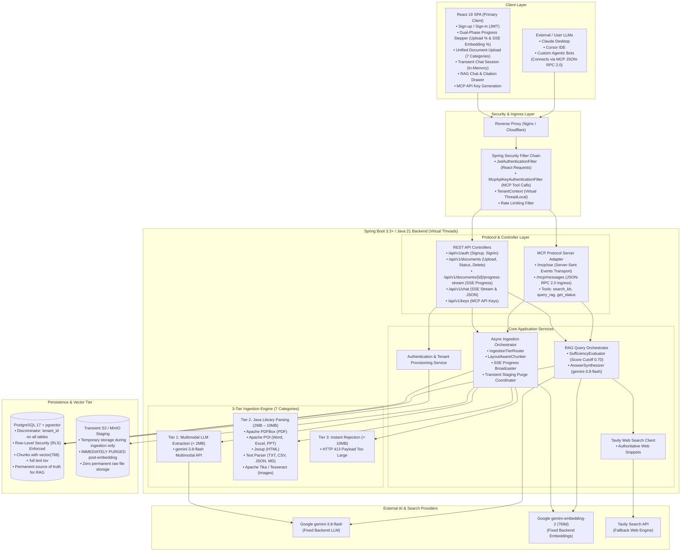
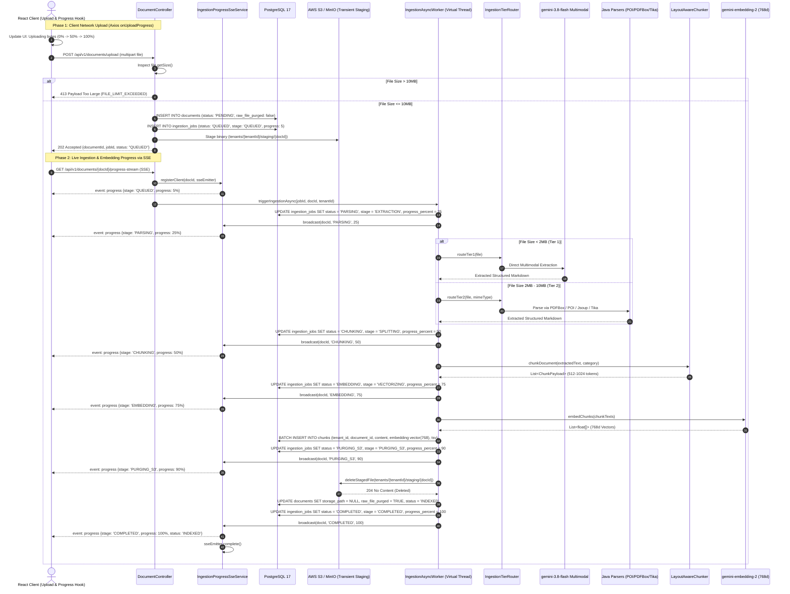
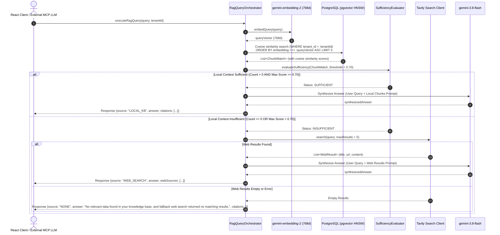
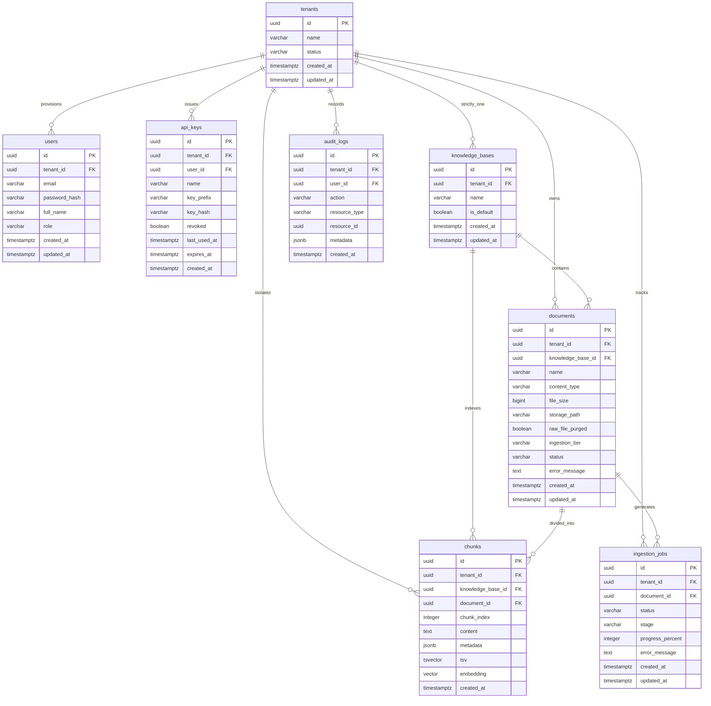

# SynapseMCP — Multi-Tenant RAG System Architecture & Database Schema

> **Document Type:** System Architecture Specification & Database DDL (`architecture.md`)  
> **Role:** Senior Software Architect  
> **Target System:** Enterprise Multi-Tenant RAG Platform with Model Context Protocol (MCP) Server and React Client  
> **Date:** October 2026  
> **Status:** Final Architectural Baseline  

---

## 1. Executive Architectural Overview

SynapseMCP is an enterprise-grade, multi-tenant Retrieval-Augmented Generation (RAG) platform. It provides a secure, highly scalable document intelligence engine where:
1. Every authenticated user is treated as an isolated tenant and possesses **strictly ONE single unified Knowledge Base (KB)**.
2. AI models are **fixed in the backend configuration**: Google **`gemini-3.8-flash`** (LLM) and Google **`gemini-embedding-2`** (Embeddings at 768 dimensions); users cannot view, select, or modify model configurations.
   *(As built: the fixed chat model is `gemini-3.5-flash-lite`, not `gemini-3.8-flash` - see ADR-02. Still fixed/non-configurable; only the identifier differs.)*
3. **Zero Permanent Cloud Object Storage:** Uploaded files are temporarily staged in S3/MinIO strictly for parsing and chunking. Once embeddings and chunks are saved to PostgreSQL, the raw files are **immediately and permanently deleted from S3**. Raw file re-downloads are disabled; users view extracted text via citation cards.
4. **Transient Client-Side Chat History:** Conversations are held in React client session state, keeping the PostgreSQL database lean and maximizing tenant privacy without conversational transcript retention.
5. **Dual-Phase Real-Time Progress Tracking:** The React frontend captures and displays continuous progress across both the client-to-server network upload (via Axios byte-progress) and server-side processing milestones (via Server-Sent Events SSE: `Parsing` -> `Chunking` -> `Embedding` -> `S3 Purge` -> `Indexed`).
6. The platform serves two distinct access paradigms simultaneously:
   - **Primary Client:** A responsive React Single-Page Application (SPA) for sign-up, sign-in, document management, real-time ingestion tracking, and conversational RAG queries with citation rendering.
   - **MCP Server Layer:** A Model Context Protocol (MCP) server running over HTTP/SSE, allowing external LLM clients (such as Claude Desktop, Cursor, and custom autonomous agents) to connect via personal API keys and query the user's isolated knowledge base as an external tool.

> **As built**, the diagram below predates several real changes, detailed in the ADRs: the chat model is
> `gemini-3.5-flash-lite` not `gemini-3.8-flash` (ADR-02); `IngestionOrchestrator` tries Tier 2 (Java parsers)
> first for every size/category, with Tier 1 (Gemini) as a `≤2MiB` fallback, not the size-routed split shown
> (ADR-05) - **except images under 2 MiB, which try Tier 1 first instead** (ADR-05, user decision, this
> session); `TavilyClient`/`TavilyAPI` are implemented as `DuckDuckGoWebSearchService` calling the DuckDuckGo
> Instant Answer API (ADR-06); `RagOrchestrator` and `McpAdapter`'s `search_user_knowledge_base` tool both now
> run the query through `QuerySpellCorrector` before embedding it (ADR-09, user decision, this session, not in
> the original design); and `McpAdapter`'s tool list is `search_user_knowledge_base`, `query_user_rag`,
> `get_ingestion_status`, **and `upload_document`** (ADR-04). The frontend also now lives in its own separate
> project, not nested under this repo.



---

## 2. Architectural Decision Records (ADRs)

### ADR-01: Strictly One Unified Knowledge Base per User (Tenant)
- **Context:** The system requires multi-tenant isolation where each user has a single consolidated repository of knowledge.
- **Decision:** When a user registers via `/api/v1/auth/signup`, the backend provisions a `users` record and automatically creates a single corresponding record in `knowledge_bases` (flagged as `is_default = true`). All documents uploaded by the user map directly to this single knowledge base.
- **Consequences:** The React UI eliminates KB management views (no create, edit, or switch KB modals). All API calls automatically resolve the user's active KB ID from their authenticated session context.

### ADR-02: Fixed Backend AI Model Configuration (`gemini-3.8-flash` & `gemini-embedding-2`)
- **Context:** The user flow specifies that model selection is fixed in the backend and cannot be viewed, chosen, or changed by end users.
- **Decision:** Spring AI is configured with fixed beans:
  - `ChatClient` configured with Google `gemini-3.8-flash`.
  - `EmbeddingModel` configured with Google `gemini-embedding-2` configured with 768-dimensional output (`vector(768)` in PostgreSQL).
- **Consequences:** Eliminates database tables for dynamic per-tenant model configurations. Zero client exposure to model parameters, API keys, or provider selection.
- **As built:** the `ChatClient` is pinned to **`gemini-3.5-flash-lite`**, not `gemini-3.8-flash` - switched
  after the free-tier `generateContent` quota (20 requests/day) on `gemini-3.8-flash`/`gemini-3.5-flash` was
  exhausted twice during development testing; both are fixed, non-user-selectable identifiers either way, so
  the ADR's decision and consequences hold unchanged. The embedding model is unchanged.

### ADR-03: Row-Level Tenancy with Discriminator Column & PostgreSQL RLS
- **Context:** Safe, multi-tenant vector and relational storage without the operational overhead of dynamic schemas.
- **Decision:** All tables (`documents`, `chunks`, `ingestion_jobs`, `api_keys`) contain a `tenant_id UUID NOT NULL` discriminator column.
  - Layer 1 (Application): Spring Data JPA repositories automatically append `WHERE tenant_id = :tenantId`.
  - Layer 2 (Database Defense-in-Depth): PostgreSQL Row-Level Security (RLS) policies enforce `tenant_id = current_setting('app.current_tenant_id')::uuid`.
- **Consequences:** High-performance queries using composite indexes `(tenant_id, id)` and guaranteed zero cross-tenant vector leakage.

### ADR-04: Bimodal Access via Integrated Spring Boot MCP Server
- **Context:** Enable external/user LLM environments (Claude Desktop, Cursor, external agents) to leverage the user's RAG knowledge base.
- **Decision:** Spring Boot embeds an MCP Server protocol adapter implementing the JSON-RPC 2.0 specification over Server-Sent Events (SSE) at `/mcp/sse`.
  - Authenticated React users can generate an MCP API key in their profile settings.
  - External LLMs supply this key via `Authorization: Bearer <mcp_api_key>` when opening the SSE transport.
  - The MCP server exposes tools: `search_user_knowledge_base`, `query_user_rag`, and `get_ingestion_status`, resolving data strictly within the authenticated tenant's context.
- **Consequences:** React frontend remains the primary web interface, while external LLMs gain native tool-calling access to the same isolated knowledge base.
- **As built:** a 4th tool, **`upload_document`** (filename + Base64 content), was added beyond the original
  3-tool scope - it lets an MCP client *populate* the knowledge base, not just query it, reusing
  `DocumentService.upload` directly so an MCP upload has identical validation/staging/parsing/chunking/
  embedding/audit behavior to the REST upload endpoint. The SSE transport and JSON-RPC 2.0 protocol handling
  are provided by the Spring AI MCP Server starter, not a hand-written protocol handler - the endpoints and
  message shapes are unchanged either way. Verified live over the real protocol: upload → poll status → query
  all work entirely through MCP tool calls, no REST access needed beyond initial authentication.

### ADR-05: 3-Tier Document Ingestion Strategy & 7 Supported Formats
- **Context:** Optimizing ingestion cost, speed, and accuracy across 7 document categories.
- **Decision:**
  - `Size < 2MB`: Multimodal LLM Direct Extraction via `gemini-3.8-flash` for visual fidelity, table extraction, and OCR.
  - `Size 2MB – 10MB`: In-process Java enterprise libraries (Apache PDFBox, Apache POI, Jsoup, Tika/Tesseract).
  - `Size > 10MB`: Instant rejection with HTTP 413 `FILE_LIMIT_EXCEEDED`.
- **Consequences:** Zero cloud API costs for large documents, while small documents benefit from state-of-the-art vision and layout parsing.
- **As built (explicit, user-approved deviation):** reversed, for every category and size - Tier 2 (Java
  parsers) is always tried first; Tier 1 (Gemini) only runs as a fallback, and only for files `≤ 2 MiB`, when
  Tier 2 fails or finds nothing. Both failing produces one combined error message. `> 10MB` rejection
  unchanged. Rationale: Java parsing is free and usually sufficient; Gemini is reserved for genuinely
  Java-unparseable content (e.g. a scanned page with no text layer) within a size Gemini can still process
  cheaply. `PdfBoxDocumentParser` gained a per-page OCR fallback (via the same Tesseract engine used for
  standalone images) for pages with no embedded text layer, so a mixed PDF only pays OCR cost where needed -
  not present in the original scope, where scanned PDFs over the Tier-1 size threshold had no OCR path at all.
- **Further as-built deviation (user decision, this session): images under 2 MiB reverse that order again.**
  `IngestionOrchestrator.extractSmallImage` tries Tier 1 (Gemini multimodal) **first** for images `≤ 2 MiB`,
  falling back to Tesseract OCR (Tier 2) only if Gemini fails or times out - the one category/size combination
  where Tier 1 runs first, not as a fallback. Rationale: Tesseract reads clean, mostly-text scans reliably but
  does poorly on stylized text, low-contrast images, or images that are mostly a diagram/photo with little
  text, whereas Gemini's multimodal model handles both text and visual content in one pass. Images `≥ 2 MiB`
  are unchanged (Tier 2 OCR only, since Tier 1 hard-rejects anything that large). Covered by
  `IngestionOrchestratorImageRoutingTest` (4 cases: Gemini succeeds, Gemini fails → OCR fallback succeeds,
  both fail → combined error naming both, large image unaffected).

### ADR-06: 3-Stage Deterministic Query Routing
- **Context:** Avoiding hallucinations and handling out-of-domain questions gracefully.
- **Decision:**
  1. Cosine similarity vector search on user's chunks (`tenant_id = :tenantId`).
  2. If chunk count == 0 OR max cosine similarity `< 0.70`, fallback to Tavily Search API.
  3. If Tavily search returns 0 results or fails, return the deterministic message:
     `"No relevant data found in your knowledge base, and fallback web search returned no matching results."`
- **Consequences:** Predictable, high-trust answers with transparent source attribution (`LOCAL_KB`, `WEB_SEARCH`, or `NONE`).
- **As built (explicit, user-approved deviation):** step 2 queries the **DuckDuckGo Instant Answer API**, not
  Tavily - free, no API key, but not a ranked multi-result search (typically a single Wikipedia-style abstract
  for a "topic" query, nothing for an ordinary one). Consequence: more queries land on step 3's deterministic
  message than a true ranked search API would produce. The `0.70` threshold and step 1's vector search are
  unchanged, except retrieval now returns the top **8** matches, not an unspecified/smaller top-K - raised
  from an initial 5 after a real multi-document test showed a correct chunk could rank outside top-5 purely
  from how many other documents were competing for the same query. Answer synthesis runs at `temperature(0.0)`
  (not an unspecified default) and groups retrieved chunks by source document in the prompt rather than flat
  rank order - both found necessary via real testing for the model to reliably use the retrieved context
  correctly (see design.md §5 for the full account).

### ADR-07: Transient S3 Staging & Immediate Raw File Purge Post-Embedding
- **Context:** Cost optimization, storage minimization, and compliance/privacy requirements.
- **Decision:** AWS S3 or MinIO is utilized strictly as a transient scratchpad/staging buffer during asynchronous processing:
  1. File is staged temporarily at `tenants/{tenantId}/staging/{docId}/{filename}`.
  2. Asynchronous worker parses, chunks, and generates vector embeddings via `gemini-embedding-2`.
  3. Chunks are committed to PostgreSQL.
  4. **Immediate Purge:** The worker executes `s3Client.deleteObject()`, permanently purging the raw binary from S3.
  5. The document record in PostgreSQL updates `storage_path = NULL` and `raw_file_purged = TRUE`.
- **Consequences:** Zero permanent S3 storage costs, maximum tenant data confidentiality. Raw file re-downloads are permanently disabled.

### ADR-08: Dual-Phase Progress Tracking (Network Upload & SSE Ingestion Stream)
- **Context:** Ingesting files up to 10MB across network upload, parsing, chunking, and embedding can take several seconds. Users need clear, non-blocking visual feedback.
- **Decision:** Implement a dual-phase progress model:
  1. **Phase 1 (Client Network Upload):** Axios `onUploadProgress` captures byte-level transmission (0% - 100%).
  2. **Phase 2 (Server Ingestion & Embedding):** Once HTTP 202 is returned, the React client opens a Server-Sent Events (SSE) connection (`GET /api/v1/documents/{id}/progress-stream`) to receive real-time stage milestones (`QUEUED` -> `PARSING` -> `CHUNKING` -> `EMBEDDING` -> `PURGING_S3` -> `COMPLETED`).
- **Consequences:** Flawless user experience with zero polling overhead and immediate visual confirmation of embedding completion.

### ADR-09: Query Spell-Correction Before Retrieval (not in the original scope; user decision, this session)
- **Context:** Retrieval in ADR-06 is pure cosine similarity over embeddings with no lexical/keyword fallback.
  A user's misspelled or typo'd query can embed far enough from the correctly-spelled query that it misses
  chunks it should have matched, pushing the request to the web-search fallback (or the deterministic failure
  message) even when the knowledge base has the answer. This affects both `POST /api/v1/chat` /
  `query_user_rag` (full RAG) and the `search_user_knowledge_base` MCP tool (plain semantic search, no
  synthesis or web fallback to catch it) equally - the second was found missing the fix during a later review
  pass in the same session and fixed to match.
- **Decision:** A new `QuerySpellCorrector` component (`rag/correction/`) sends the raw query to the same
  fixed Gemini chat model (`gemini-3.5-flash-lite`) with a correction-only prompt (preserve meaning, names,
  domain terms; fix only spelling/typos) before the query is embedded. It is deliberately **best-effort**:
  any failure (timeout, API error, blank output) falls back silently to the original, uncorrected query -
  bounded by its own `synapse.query.correction.timeout` (`PT5S`), same `future.get(timeout)` pattern as Tier 1
  extraction and answer synthesis, since a hung Gemini call must not hang the whole chat request. The
  corrected text (when it differs) is used consistently for retrieval, web search, and answer synthesis, and
  surfaced back to the REST/MCP caller as `ChatResponse.correctedQuery` (null when nothing changed) so a
  client can optionally show a "Showing results for: ..." hint.
- **Consequences:** One extra lightweight Gemini call per chat/search request (latency ~0.5-2s typical,
  bounded at 5s worst case before falling back), partially offsetting ADR-06's accuracy gap for typo'd
  queries. No change to the `0.70` similarity threshold or the 3-stage routing itself - correction runs
  before retrieval starts, not as a new routing branch. Covered by `QuerySpellCorrectorTest` (6 cases incl.
  hung-call timeout and API-error fallback) and new cases in `RagQueryOrchestratorTest` /
  `SearchKnowledgeBaseToolTest`.

---

## 3. Subsystem Architecture

### 3.1 Security & Tenant Context Subsystem
The security subsystem guarantees tenant isolation across HTTP REST endpoints and MCP SSE connections:

```mermaid
flowchart LR
    Request[Incoming HTTP Request] --> PathFilter{Path Prefix?}
    
    PathFilter -->|/api/v1/auth/**| PermitAll[Permit All<br/>(Signup / Signin)]
    PathFilter -->|/api/v1/**| JwtFilter[JwtAuthenticationFilter]
    PathFilter -->|/mcp/**| McpFilter[McpApiKeyAuthenticationFilter]
    
    JwtFilter --> ValidateJwt{Valid JWT?}
    ValidateJwt -->|Yes| ExtractTenantJwt[Extract userId / tenantId<br/>Set SecurityContext]
    ValidateJwt -->|No| Reject401[401 Unauthorized]
    
    McpFilter --> ValidateKey{Valid API Key Hash?}
    ValidateKey -->|Yes| ExtractTenantKey[Lookup api_keys<br/>Extract tenantId<br/>Set SecurityContext]
    ValidateKey -->|No| Reject401
    
    ExtractTenantJwt --> TenantContextInit[TenantContext.setTenantId(tenantId)]
    ExtractTenantKey --> TenantContextInit
    
    TenantContextInit --> ControllerExecution[Execute Controller / Virtual Thread]
    ControllerExecution --> FinallyBlock[TenantContext.clear()]
```

---

### 3.2 Asynchronous Ingestion & Dual-Phase Progress Subsystem

> **As built:** the `alt File Size < 2MB (Tier 1) / else (Tier 2)` branch below is reversed - Tier 2 (Java
> parsers) always runs first; Tier 1 (Gemini) only runs as a fallback for files `≤ 2 MiB` when Tier 2 fails
> or finds nothing (ADR-05). There is no separate `IngestionTierRouter` class - the decision lives directly
> in the ingestion orchestrator's extraction step.



---

### 3.3 Query Routing & Fallback Subsystem

> **As built:** `Tavily`/`TavilyAPI` below are the DuckDuckGo Instant Answer API (ADR-06) - typically zero or
> one result, not a ranked `maxResults = 5`. `LIMIT 5` in the vector search is **`LIMIT 8`** as built (`TOP_K=8`).
> `FixedLLM` is `gemini-3.5-flash-lite` at `temperature(0.0)`, and client-sent conversation history (not shown
> below) is folded into the query and passed to synthesis as context only - see design.md §5.



---

### 3.4 Model Context Protocol (MCP) Server Subsystem
The Spring Boot backend exposes an integrated MCP Server layer adhering to the Model Context Protocol:

> **As built:** a 4th tool, `upload_document`, is registered alongside the three shown below (ADR-04) - it
> lets an MCP client add a file to the knowledge base via Base64 content, reusing the exact same upload
> pipeline as the REST endpoint. `ProtocolHandler` is the Spring AI MCP Server starter's built-in JSON-RPC 2.0
> handling, not a hand-written class, though the message flow shown is accurate.

```mermaid
flowchart TD
    subgraph ExternalHost["External LLM Client (Claude Desktop / Cursor / IDE)"]
        UserPrompt["User asks external LLM:<br/>'What is our Q3 cloud budget in my knowledge base?'"]
        McpClientCore["MCP Client Implementation"]
    end

    subgraph SpringBootMCP["Spring Boot MCP Server Layer"]
        SseEndpoint["/mcp/sse (Transport Ingress)"]
        ApiKeyValidator["McpApiKeyAuthenticationFilter<br/>(Extracts tenantId from Bearer API Key)"]
        ProtocolHandler["JSON-RPC 2.0 Protocol Handler"]
        
        subgraph ToolRegistry["Registered MCP Tools"]
            Tool1["search_user_knowledge_base<br/>• semantic search returning chunks"]
            Tool2["query_user_rag<br/>• full RAG with local + Tavily fallback"]
            Tool3["get_ingestion_status<br/>• check status of document ingestion"]
        end
    end

    subgraph TenantRAG["Tenant Isolated Knowledge Base"]
        TenantChunks[("PostgreSQL pgvector<br/>(WHERE tenant_id = :tenantId)")]
    end

    UserPrompt --> McpClientCore
    McpClientCore -->|1. Connect SSE with Bearer Key| SseEndpoint
    SseEndpoint --> ApiKeyValidator
    ApiKeyValidator --> ProtocolHandler
    McpClientCore -->|2. tools/list| ProtocolHandler
    ProtocolHandler -->>|3. Tool definitions schema| McpClientCore
    McpClientCore -->|4. tools/call: query_user_rag| ProtocolHandler
    ProtocolHandler --> Tool2
    Tool2 --> TenantChunks
    TenantChunks -->> Tool2
    Tool2 -->>|5. Tool Call Result (JSON)| ProtocolHandler
    ProtocolHandler -->>|6. JSON-RPC Result| McpClientCore
    McpClientCore -->> UserPrompt
```

---

## 4. Comprehensive Database Architecture & DDL

### 4.1 Entity-Relationship Diagram (ERD)



---

### 4.2 Production PostgreSQL 17 + pgvector DDL with Row-Level Security (RLS)

```sql
-- ============================================================================
-- SynapseMCP Multi-Tenant RAG Schema DDL
-- Target Engine: PostgreSQL 17+ with pgvector
-- Isolation: Row-Level Security (RLS) + Discriminator tenant_id
-- Fixed AI Model: gemini-embedding-2 (vector(768))
-- Storage: Zero Permanent S3 Storage (raw_file_purged flag)
-- Ingestion: Detailed Stages (QUEUED, PARSING, CHUNKING, EMBEDDING, PURGING_S3, COMPLETED)
-- ============================================================================

-- 1. Enable Required Extensions
CREATE EXTENSION IF NOT EXISTS vector;
CREATE EXTENSION IF NOT EXISTS "uuid-ossp";

-- 2. Tenants Table
CREATE TABLE tenants (
    id UUID PRIMARY KEY DEFAULT gen_random_uuid(),
    name VARCHAR(255) NOT NULL,
    status VARCHAR(50) NOT NULL DEFAULT 'ACTIVE',
    created_at TIMESTAMPTZ NOT NULL DEFAULT NOW(),
    updated_at TIMESTAMPTZ NOT NULL DEFAULT NOW(),
    CONSTRAINT chk_tenants_status CHECK (status IN ('ACTIVE', 'SUSPENDED', 'DELETED'))
);
CREATE INDEX idx_tenants_status ON tenants (status);

-- 3. Users Table (Sign-up / Sign-in)
CREATE TABLE users (
    id UUID PRIMARY KEY DEFAULT gen_random_uuid(),
    tenant_id UUID NOT NULL REFERENCES tenants(id) ON DELETE CASCADE,
    email VARCHAR(255) NOT NULL,
    password_hash VARCHAR(255) NOT NULL,
    full_name VARCHAR(255) NOT NULL,
    role VARCHAR(50) NOT NULL DEFAULT 'USER',
    created_at TIMESTAMPTZ NOT NULL DEFAULT NOW(),
    updated_at TIMESTAMPTZ NOT NULL DEFAULT NOW(),
    CONSTRAINT chk_users_role CHECK (role IN ('ADMIN', 'USER', 'READ_ONLY'))
);
CREATE UNIQUE INDEX uq_users_email_ci ON users (LOWER(email));
CREATE INDEX idx_users_tenant ON users (tenant_id);

-- 4. API Keys Table (MCP External LLM Access)
CREATE TABLE api_keys (
    id UUID PRIMARY KEY DEFAULT gen_random_uuid(),
    tenant_id UUID NOT NULL REFERENCES tenants(id) ON DELETE CASCADE,
    user_id UUID NOT NULL REFERENCES users(id) ON DELETE CASCADE,
    name VARCHAR(100) NOT NULL DEFAULT 'Default MCP Key',
    key_prefix VARCHAR(16) NOT NULL,
    key_hash VARCHAR(64) NOT NULL, -- SHA-256 hash of plaintext key
    revoked BOOLEAN NOT NULL DEFAULT FALSE,
    last_used_at TIMESTAMPTZ,
    expires_at TIMESTAMPTZ,
    created_at TIMESTAMPTZ NOT NULL DEFAULT NOW()
);
CREATE UNIQUE INDEX uq_api_keys_hash ON api_keys (key_hash);
CREATE INDEX idx_api_keys_tenant ON api_keys (tenant_id);

-- 5. Knowledge Bases Table (Strictly 1 Unified KB per Tenant)
CREATE TABLE knowledge_bases (
    id UUID PRIMARY KEY DEFAULT gen_random_uuid(),
    tenant_id UUID NOT NULL REFERENCES tenants(id) ON DELETE CASCADE,
    name VARCHAR(255) NOT NULL DEFAULT 'Default Knowledge Base',
    is_default BOOLEAN NOT NULL DEFAULT TRUE,
    created_at TIMESTAMPTZ NOT NULL DEFAULT NOW(),
    updated_at TIMESTAMPTZ NOT NULL DEFAULT NOW(),
    CONSTRAINT uq_tenant_single_kb UNIQUE (tenant_id) -- Guarantees strictly ONE KB per tenant
);
CREATE INDEX idx_knowledge_bases_tenant ON knowledge_bases (tenant_id);

-- 6. Documents Table (7 File Categories, Max 10MB, Staged & Purged from S3)
CREATE TABLE documents (
    id UUID PRIMARY KEY DEFAULT gen_random_uuid(),
    tenant_id UUID NOT NULL REFERENCES tenants(id) ON DELETE CASCADE,
    knowledge_base_id UUID NOT NULL REFERENCES knowledge_bases(id) ON DELETE CASCADE,
    name VARCHAR(500) NOT NULL,
    content_type VARCHAR(150) NOT NULL,
    file_size BIGINT NOT NULL,
    storage_path VARCHAR(1000), -- Populated during staging; set to NULL after S3 deletion
    raw_file_purged BOOLEAN NOT NULL DEFAULT FALSE, -- Set to TRUE once S3 file is deleted
    ingestion_tier VARCHAR(50) NOT NULL,
    status VARCHAR(50) NOT NULL DEFAULT 'PENDING',
    error_message TEXT,
    created_at TIMESTAMPTZ NOT NULL DEFAULT NOW(),
    updated_at TIMESTAMPTZ NOT NULL DEFAULT NOW(),
    CONSTRAINT chk_documents_size CHECK (file_size > 0 AND file_size <= 10485760), -- Max 10MB
    CONSTRAINT chk_documents_tier CHECK (ingestion_tier IN ('TIER_1_MULTIMODAL', 'TIER_2_JAVA_PARSER')),
    CONSTRAINT chk_documents_status CHECK (status IN ('PENDING', 'PROCESSING', 'INDEXED', 'FAILED', 'REJECTED'))
);
CREATE INDEX idx_documents_tenant_kb ON documents (tenant_id, knowledge_base_id);
CREATE INDEX idx_documents_status ON documents (status);

-- 7. Ingestion Jobs Table (Multi-Stage Asynchronous Progress Tracking)
CREATE TABLE ingestion_jobs (
    id UUID PRIMARY KEY DEFAULT gen_random_uuid(),
    tenant_id UUID NOT NULL REFERENCES tenants(id) ON DELETE CASCADE,
    document_id UUID NOT NULL REFERENCES documents(id) ON DELETE CASCADE,
    status VARCHAR(50) NOT NULL DEFAULT 'QUEUED',
    stage VARCHAR(50) NOT NULL DEFAULT 'QUEUED',
    progress_percent INTEGER NOT NULL DEFAULT 0,
    error_message TEXT,
    created_at TIMESTAMPTZ NOT NULL DEFAULT NOW(),
    updated_at TIMESTAMPTZ NOT NULL DEFAULT NOW(),
    CONSTRAINT chk_jobs_status CHECK (status IN ('QUEUED', 'PARSING', 'CHUNKING', 'EMBEDDING', 'PURGING_S3', 'COMPLETED', 'FAILED')),
    CONSTRAINT chk_jobs_stage CHECK (stage IN ('QUEUED', 'EXTRACTION', 'SPLITTING', 'VECTORIZING', 'PURGING_S3', 'COMPLETED', 'FAILED')),
    CONSTRAINT chk_jobs_progress CHECK (progress_percent BETWEEN 0 AND 100)
);
CREATE INDEX idx_ingestion_jobs_tenant ON ingestion_jobs (tenant_id);
CREATE INDEX idx_ingestion_jobs_doc ON ingestion_jobs (document_id);

-- 8. Chunks Table (Fixed gemini-embedding-2 768d Vectors & Hybrid Lexical Text)
CREATE TABLE chunks (
    id UUID PRIMARY KEY DEFAULT gen_random_uuid(),
    tenant_id UUID NOT NULL REFERENCES tenants(id) ON DELETE CASCADE,
    knowledge_base_id UUID NOT NULL REFERENCES knowledge_bases(id) ON DELETE CASCADE,
    document_id UUID NOT NULL REFERENCES documents(id) ON DELETE CASCADE,
    chunk_index INTEGER NOT NULL,
    content TEXT NOT NULL,
    metadata JSONB NOT NULL DEFAULT '{}'::jsonb,
    
    -- Lexical Search Column (GIN Indexed)
    tsv TSVECTOR GENERATED ALWAYS AS (to_tsvector('english', content)) STORED,
    
    -- Fixed 768-dimensional Vector Column from Google gemini-embedding-2
    embedding vector(768) NOT NULL,
    
    created_at TIMESTAMPTZ NOT NULL DEFAULT NOW()
);

-- Plain Indexes
CREATE INDEX idx_chunks_tenant_kb ON chunks (tenant_id, knowledge_base_id);
CREATE INDEX idx_chunks_document ON chunks (document_id);
CREATE INDEX idx_chunks_tsv ON chunks USING gin (tsv);
CREATE INDEX idx_chunks_metadata_gin ON chunks USING gin (metadata);

-- HNSW Vector Index (Cosine Distance, optimized for 768d multi-tenant throughput)
CREATE INDEX idx_chunks_embedding_hnsw ON chunks 
    USING hnsw (embedding vector_cosine_ops) 
    WITH (m = 16, ef_construction = 64);

-- 9. Audit Logs Table
CREATE TABLE audit_logs (
    id UUID PRIMARY KEY DEFAULT gen_random_uuid(),
    tenant_id UUID NOT NULL REFERENCES tenants(id) ON DELETE CASCADE,
    user_id UUID REFERENCES users(id) ON DELETE SET NULL,
    action VARCHAR(100) NOT NULL,
    resource_type VARCHAR(100) NOT NULL,
    resource_id UUID,
    metadata JSONB DEFAULT '{}'::jsonb,
    created_at TIMESTAMPTZ NOT NULL DEFAULT NOW()
);
CREATE INDEX idx_audit_logs_tenant_time ON audit_logs (tenant_id, created_at DESC);

-- ============================================================================
-- ROW-LEVEL SECURITY (RLS) POLICIES
-- Defense-in-depth isolation preventing accidental cross-tenant data access
-- ============================================================================

-- Enable RLS on Tenant-Partitioned Tables
ALTER TABLE documents ENABLE ROW LEVEL SECURITY;
ALTER TABLE chunks ENABLE ROW LEVEL SECURITY;
ALTER TABLE ingestion_jobs ENABLE ROW LEVEL SECURITY;
ALTER TABLE api_keys ENABLE ROW LEVEL SECURITY;
ALTER TABLE knowledge_bases ENABLE ROW LEVEL SECURITY;

-- Create Policies based on 'app.current_tenant_id' session variable
CREATE POLICY tenant_isolation_documents ON documents
    FOR ALL
    USING (tenant_id = NULLIF(current_setting('app.current_tenant_id', true), '')::uuid);

CREATE POLICY tenant_isolation_chunks ON chunks
    FOR ALL
    USING (tenant_id = NULLIF(current_setting('app.current_tenant_id', true), '')::uuid);

CREATE POLICY tenant_isolation_jobs ON ingestion_jobs
    FOR ALL
    USING (tenant_id = NULLIF(current_setting('app.current_tenant_id', true), '')::uuid);

CREATE POLICY tenant_isolation_api_keys ON api_keys
    FOR ALL
    USING (tenant_id = NULLIF(current_setting('app.current_tenant_id', true), '')::uuid);

CREATE POLICY tenant_isolation_kb ON knowledge_bases
    FOR ALL
    USING (tenant_id = NULLIF(current_setting('app.current_tenant_id', true), '')::uuid);
```

---

## 5. Non-Functional Requirements & System SLAs

| Architectural Pillar | Target SLA | Implementation Guarantee |
|---|---|---|
| **Local RAG Retrieval Latency** | `< 600ms` (P95) | 768d HNSW Cosine Index with `ef_search = 40`; `(tenant_id, knowledge_base_id)` pre-filtered partition scan. |
| **End-to-End Chat Latency (Local)** | `< 1800ms` (P95) | Fast backend LLM (`gemini-3.8-flash`), non-blocking Virtual Threads, SSE streaming response. |
| **Upload & Ingestion UI Latency** | `< 100ms` UI update latency | Real-time byte tracking via Axios `onUploadProgress` + server push via SSE emitter (`progress-stream`). |
| **Web Search Fallback Latency** | `< 2500ms` (P95) | Asynchronous HTTP client to Tavily API (timeout set to 2.0s); streaming answer synthesis. *(As built: DuckDuckGo Instant Answer API, not Tavily - see ADR-06.)* |
| **Ingestion Pipeline Throughput** | `60 docs/minute` per node | Non-blocking upload streams, `@Async` worker pool running on Java 21 Virtual Threads, batch vector insertion. |
| **Zero S3 Permanent Footprint** | `0 GB` steady state | Raw uploaded files are deleted from S3 immediately upon chunk vector insertion into PostgreSQL. |
| **Tenant Isolation Guarantee** | 100% Mathematical Certainty | Double-guard: JPA query parameter binding + PostgreSQL Row-Level Security (RLS) policies. |
| **Availability & Fault Tolerance** | `99.9%` Uptime | Stateless Spring Boot backend containers; managed PostgreSQL with Multi-AZ replication; circuit breakers on external LLM and Tavily APIs. |
