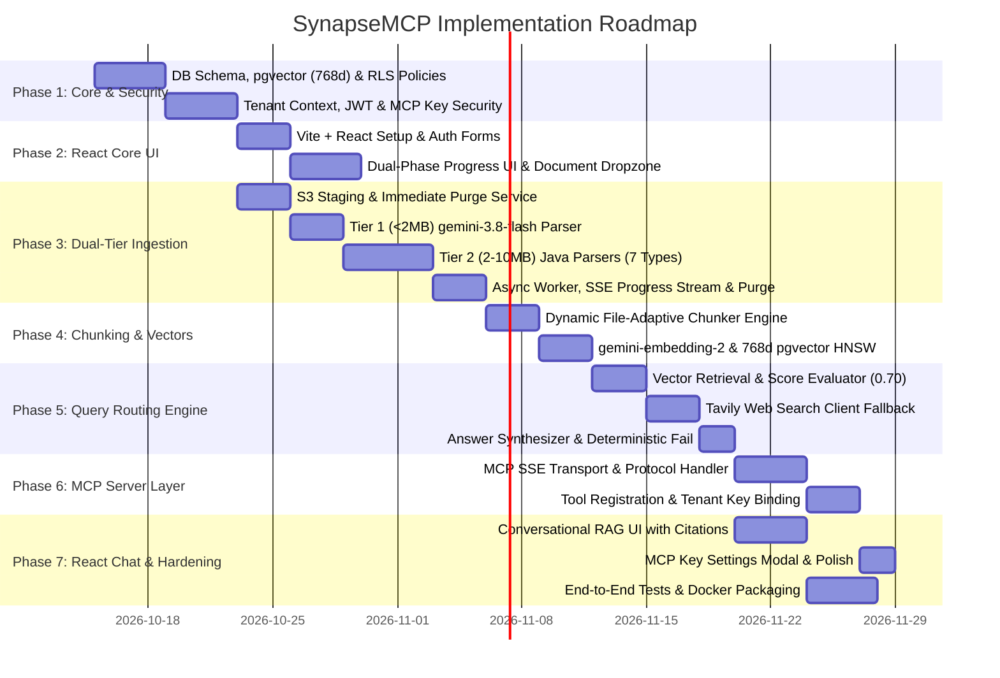

# SynapseMCP — Multi-Tenant RAG Application Implementation Plan

> **Document Type:** Project Implementation Plan (`plan.md`)  
> **Role:** Senior Software Architect  
> **Target System:** Enterprise Multi-Tenant RAG Platform with Model Context Protocol (MCP) Server and React Client  
> **Date:** October 2026  
> **Status:** Final Architectural Baseline  

---

## 1. Executive Summary & System Vision

SynapseMCP is an enterprise-grade multi-tenant Retrieval-Augmented Generation (RAG) platform with native Model Context Protocol (MCP) server support. The platform connects proprietary enterprise files with cutting-edge Large Language Models while guaranteeing tenant isolation, predictable low-cost ingestion, and high-trust answers.

### 1.1 Core Architectural Invariants
- **Strictly ONE Unified Knowledge Base per User:**
  - Upon user sign-up, the platform automatically provisions exactly one unified Knowledge Base.
  - All uploaded documents automatically map to this single KB.
  - Users have no ability or UI to create, switch, or manage multiple knowledge bases.
- **Fixed Backend AI Models (`gemini-3.8-flash` & `gemini-embedding-2`):**
  - Models are fixed in the backend environment: Google **`gemini-3.8-flash`** (LLM) and Google **`gemini-embedding-2`** (Embeddings at 768 dimensions).
  - Users cannot view, select, or modify model providers or model identifiers.
  - **As built:** the chat model is pinned to **`gemini-3.5-flash-lite`**, not `gemini-3.8-flash` - switched after the free-tier `generateContent` quota (20 requests/day) on `gemini-3.8-flash`/`gemini-3.5-flash` was exhausted twice during development testing. The embedding model (`gemini-embedding-2`, 768d) is unchanged. The invariant itself (fixed, non-configurable backend models) is intact - only the specific chat model identifier differs.
- **Zero Permanent Cloud Object Storage (Transient S3 Staging & Purge):**
  - Uploaded files are **NOT stored permanently** in AWS S3 or MinIO.
  - S3/MinIO is used strictly as a transient staging buffer while the asynchronous worker processes the document.
  - Once extracted text chunks and vector embeddings are safely committed into PostgreSQL, the staged binary in S3 is **immediately and permanently deleted**. Raw file re-downloads are permanently disabled.
- **Transient Client-Side Chat History:**
  - Conversations are held in React client session state, keeping PostgreSQL lean and ensuring complete conversational privacy.
- **Dual-Phase Real-Time Ingestion Progress Tracking:**
  - The React frontend provides seamless, unbroken visual feedback across two distinct phases:
    - **Phase 1 (Network Upload):** Real-time network upload progress (0% – 100%) tracking bytes sent via Axios `onUploadProgress`.
    - **Phase 2 (Server Ingestion & Embedding):** Live progress milestones via Server-Sent Events (SSE: `QUEUED` -> `PARSING` -> `CHUNKING` -> `EMBEDDING` -> `PURGING_S3` -> `INDEXED`).
- **Streamlined Authentication:**
  - Users can only **Sign-up** and **Sign-in**. No complex organizational management or inviting flows.
- **Bimodal Consumption Interfaces:**
  - **Primary Web Client:** React Single-Page Application (SPA) providing unified document upload, real-time ingestion status tracking, and conversational RAG chat with rich citations.
  - **MCP Server Layer:** Spring Boot exposes an integrated Model Context Protocol (MCP) Server over HTTP/SSE, enabling external LLM clients (Claude Desktop, Cursor, external AI agents) to connect via personal API keys and query the user's isolated knowledge base.
- **Size-Driven Ingestion Pipeline (7 Categories):**
  - `< 2MB`: LLM Multimodal / Direct extraction via `gemini-3.8-flash`.
  - `2MB – 10MB`: High-speed in-process Java enterprise parsers (Apache PDFBox, Apache POI, Jsoup, Tika/Tesseract).
  - `> 10MB`: Instant fail-fast rejection with HTTP 413 `FILE_LIMIT_EXCEEDED`.
  - **As built (explicit, user-approved deviation):** reversed, for every category and size. The Java parsers (Tier 2) are **always tried first**; the Gemini multimodal extractor (Tier 1) is used only as a **fallback**, and only for files `≤ 2 MiB`. If both fail, the job fails with a combined error message. The `> 10MB` hard rejection is unchanged. Rationale: Java parsing is free and usually sufficient; Gemini is reserved for the cases Java genuinely can't handle (e.g. a scanned PDF/image with no text layer) within the size Gemini can still process cheaply.
- **3-Stage Query Routing & Deterministic Fallback:**
  - Step 1: User's single isolated vector KB search in PostgreSQL `pgvector`.
  - Step 2: Fallback to Tavily Search API if local similarity score `< 0.70` or `0 chunks matched`.
  - Step 3: Return explicit deterministic message if web search also fails.
  - **As built (explicit, user-approved deviation):** Step 2 uses the free **DuckDuckGo Instant Answer API**, not Tavily (no API key available/desired for this project). DuckDuckGo's Instant Answer API is not a ranked multi-result search - it mostly returns a single Wikipedia-style abstract for "topic" queries and nothing for ordinary ones. Consequence: more queries land on Step 3's deterministic failure message than a true ranked search API (Tavily) would produce. The `< 0.70` similarity threshold for triggering Step 2 is unchanged, though retrieval now returns the top **8** chunks, not a smaller top-K (see Milestone 5.1).

---

## 2. Technical Stack Specification

| Component | Technology | Rationale & Specifications |
|---|---|---|
| **Frontend** | React 19 + Vite + TypeScript | Modern single-page application (SPA) in `/frontend`, TailwindCSS / modern CSS tokens, Lucide icons, Axios with JWT interceptors, dual-phase progress stepper. |
| **Backend Runtime** | Java 21 (LTS) | Virtual Threads (Project Loom) for lightweight concurrency during document parsing, API calls, SSE streaming, and vector operations. |
| **Backend Framework** | Spring Boot 3.3+ / 4.x | Spring AI, Spring Data JPA, Spring Security (Stateless JWT + MCP API Key filters), Spring Validation, `SseEmitter` progress broadcaster. |
| **Primary Datastore** | PostgreSQL 17+ with `pgvector` | Relational tables with discriminator `tenant_id`, PostgreSQL Row-Level Security (RLS), HNSW cosine distance index on 768d vectors (`vector(768)`). |
| **Transient Storage** | AWS S3 / MinIO / Local FS Staging | **Zero Permanent S3 Storage:** Staged files are read by async workers and deleted immediately after vector embeddings are persisted. |
| **AI Model (LLM - Fixed)** | Google `gemini-3.8-flash` *(as built: `gemini-3.5-flash-lite`, see §1.1)* | Fixed backend model configured in `application.yml` for multimodal extraction and synthesis. |
| **AI Model (Embedding - Fixed)** | Google `gemini-embedding-2` | Fixed backend model producing 768-dimensional vectors stored in `chunks.embedding`. |
| **Document Parsers** | Apache PDFBox, Apache POI, Jsoup, Tika | In-process, zero-cloud-cost parsing for all categories/sizes as the primary tier (see §1.1); Tika's OCR role is filled by **Tess4J (Tesseract)** directly, not Tika, and PDFBox gained a real per-page OCR fallback for scanned/mixed PDFs. |
| **Fallback Web Search** | Tavily Search API *(as built: DuckDuckGo Instant Answer API, see §1.1)* | High-accuracy web search invoked when local similarity score falls below `0.70`. |
| **External LLM Protocol** | Model Context Protocol (MCP) | Spring Boot embedded MCP Server exposing tools over HTTP/SSE for external LLM assistants. |

---

## 3. Phased Implementation Roadmap

---

## 4. Work Breakdown Structure (WBS) & Milestones

### Phase 1: Core Architecture, Database & Multi-Tenant Security
- **Milestone 1.1: PostgreSQL 17 & pgvector Setup**
  - Enable `vector` and `uuid-ossp` extensions.
  - Implement JPA entities: `Tenant`, `User`, `ApiKey`, `KnowledgeBase`, `Document`, `Chunk`, `IngestionJob`, `AuditLog`.
  - Execute DDL creating HNSW index on `chunks.embedding` (`vector(768)`), GIN index on `chunks.tsv`, and check constraints.
  - Configure PostgreSQL Row-Level Security (RLS) policies on all tenant tables using `app.current_tenant_id`.
- **Milestone 1.2: Tenant Context & Dual Authentication**
  - Implement `TenantContext` using `ThreadLocal<UUID>` with Virtual Thread propagation via `TaskDecorator`.
  - `JwtAuthenticationFilter`: Validates JWT tokens from React client requests; extracts `tenantId` and `userId`.
  - `McpApiKeyAuthenticationFilter`: Validates SHA-256 hashed API keys from MCP SSE connections; maps key to `tenantId`.
  - Automatic provisioning: On user registration (`POST /api/v1/auth/signup`), atomically create user, tenant, and the user's single default Knowledge Base.

### Phase 2: React Frontend Core Architecture (`/frontend`)
- **Milestone 2.1: Project Setup & Authentication Screens**
  - Initialize React 19 + TypeScript + Vite template.
  - Implement `AuthContext`, JWT storage, and Axios interceptor with automatic redirect on 401.
  - Build `LoginForm.tsx` and `SignupForm.tsx` with validation and error toasts.
- **Milestone 2.2: Dual-Phase Progress UI & Document Workspace**
  - Build `AppHeader.tsx` displaying user details, logout, and "Connect External LLM" button.
  - Build `DocumentUploadDropzone.tsx`:
    - Validates file extensions across the 7 categories.
    - Enforces client-side check `file.size <= 10MB` with immediate error alert.
  - Build `FileUploadProgressCard.tsx` and `IngestionStepper.tsx`:
    - Visualizes network upload byte percentage (0% – 100%) during HTTP POST transmission.
    - Transitions to real-time SSE progress milestones (`QUEUED` -> `PARSING` -> `CHUNKING` -> `EMBEDDING` -> `PURGING_S3` -> `INDEXED`).
  - Implement `useFileUploadWithProgress.ts` custom hook coordinating Axios progress and EventSource connection.
  - Build `DocumentTable.tsx` displaying document name, size, category badge, status badge (`INDEXED - S3 Purged`), and delete action.

### Phase 3: Dual-Tier Ingestion & Transient S3 Purge Engine
- **Milestone 3.1: Transient S3 Staging & Purge Service**
  - Implement `DocumentStorageService`:
    - `stageFile(...)`: Stages incoming file stream temporarily to `tenants/{tenantId}/staging/{docId}/{filename}`.
    - `purgeStagedFile(...)`: Executes `s3Client.deleteObject(...)` immediately after vector database insertion.
  - Configure 24-hour S3 bucket lifecycle expiration rule as a fallback safety net for orphaned staging objects.
  - Build `POST /api/v1/documents/upload` returning HTTP 202 `Accepted` with `documentId` and `jobId`.
  - Enforce size rejection: Files `> 10MB` return HTTP 413 `FILE_LIMIT_EXCEEDED` before reading into memory.
- **Milestone 3.2: Tier 1 Multimodal LLM Extraction (< 2MB)**
  - Implement `MultimodalLlmExtractor` using fixed Google `gemini-3.8-flash` Multimodal API.
  - Send raw binary/base64 for PDFs, images, HTML, and text to extract clean structured Markdown.
  - **As built:** this extractor is now the Tier 2 **fallback**, not the primary tier, for files `≤ 2 MiB` across every category (see §1.1); the model is `gemini-3.5-flash-lite`.
  - **Further as-built change (user decision, a later session):** for images specifically, under 2 MiB, this ordering flips back - Tier 1 (this extractor) runs FIRST, with Tier 2 (Tesseract OCR) as the fallback on failure. Rationale: Tesseract handles clean text scans well but poorly on stylized/low-contrast/mostly-visual images, where Gemini's multimodal model does better. Images ≥ 2 MiB are unaffected. See `IngestionOrchestrator.extractSmallImage` and `IngestionOrchestratorImageRoutingTest` (4 cases).
- **Milestone 3.3: Tier 2 Java Enterprise Parsers (2MB – 10MB)**
  - Implement `DocumentParserStrategy` across all 7 categories:
    - `PdfBoxDocumentParser`: Layout and text extraction from `.pdf`.
    - `PoiWordDocumentParser`: Apache POI extraction for `.doc` and `.docx`.
    - `PoiExcelDocumentParser`: Sheet extraction transforming rows into structured Markdown tables with header preservation.
    - `PoiPptDocumentParser`: Slide-by-slide text and speaker notes for `.ppt` and `.pptx`.
    - `JsoupHtmlDocumentParser`: DOM cleaner extracting sanitized text from `.html` and `.htm`.
    - `TextDocumentParser`: Direct streaming UTF-8 reader for `.txt`, `.csv`, `.md`, `.json`.
    - `TikaOcrDocumentParser`: OCR extraction for `.png`, `.jpg`, `.jpeg`, `.webp`.
  - **As built:** this is now the **primary** tier for every category/size, not just 2–10MB (see §1.1). `TikaOcrDocumentParser` was built as `TesseractOcrDocumentParser` using Tess4J directly (not Apache Tika) - it bundles English `tessdata` and splits mixed-contrast images into brightness bands, each OCR'd with the right polarity. `PdfBoxDocumentParser` gained a capability not in the original scope: a scanned page (or an image dropped into an otherwise-text PDF) with no embedded text layer is rendered and OCR'd per-page via the same Tesseract engine, so a mixed PDF only pays OCR cost on the pages that need it - there is no PDF-level "no OCR, fails with a message" limitation anymore. A `PoiPptDocumentParser` fix (not in original scope): a slide with no title and only empty/decorative shapes is skipped entirely rather than emitting a content-free `## Slide N` heading stub, which would otherwise pollute the knowledge base.
- **Milestone 3.4: Asynchronous Worker, Real-Time SSE Broadcaster & S3 Purge**
  - Implement `@Async("ingestionExecutor")` worker on Java 21 Virtual Threads.
  - Implement `IngestionProgressSseService` with `GET /api/v1/documents/{id}/progress-stream` endpoint using `SseEmitter`.
  - Broadcast real-time stages: `PARSING` (25%), `CHUNKING` (50%), `EMBEDDING` (75%), `PURGING_S3` (90%), `COMPLETED` (100%).
  - Trigger `purgeStagedFile` immediately after embedding batch insert into PostgreSQL.
  - Update `documents.raw_file_purged = TRUE` and `documents.storage_path = NULL`.

### Phase 4: Dynamic File Chunking & Vector Indexing
- **Milestone 4.1: Category-Adaptive Dynamic Chunking**
  - Implement `DynamicChunker` with category-specific strategies:
    - **Excel:** 128–384 tokens; dynamically inject sheet name and column headers into every chunk.
    - **PowerPoint:** 100–400 tokens; exactly 1 chunk per slide with title, bullets, and speaker notes.
    - **Word & Markdown:** 400–768 tokens; heading-aware hierarchical splitting.
    - **PDF:** 512–1024 tokens; layout and heading-aware semantic splitting.
    - **HTML:** 400–768 tokens; DOM semantic tag boundary preservation.
    - **Text / Code:** 256–512 tokens; JSON object and CSV header preservation.
    - **Images (OCR):** 128–512 tokens; spatial region and bounding-box grouping.
  - **As built:** word count is used as the token-count proxy throughout (no tokenizer dependency). Images use **one chunk per OCR'd line**, not spatial/bounding-box grouping - Tess4J's output as extracted carries no bounding-box data through to the chunker, so true spatial grouping was not attempted; per-line chunking was built instead after a real test found one word-count-targeted chunk per image diluted retrieval (a title and a detail fact competing for one chunk's relevance score). PDFs additionally get a fact-sheet-style strategy: a PDF with many short ALL-CAPS standalone-line headings and small average section size is split one chunk per section instead of packed to the word target - built after a real user PDF showed the same dilution problem at document scale.
- **Milestone 4.2: Fixed Embedding Generation & pgvector Insertion**
  - Integrate Spring AI `EmbeddingModel` configured with fixed Google `gemini-embedding-2` (768d).
  - Generate embeddings for each chunk and perform batch insert into PostgreSQL `chunks` table.
  - Verify HNSW cosine distance index traversal on `vector(768)`.

### Phase 5: Query Routing Engine & Fallback Pipeline
- **Milestone 5.1: Vector Retrieval & Sufficiency Evaluator**
  - Implement `VectorRetriever` querying `chunks` table enforcing `WHERE tenant_id = :tenantId`.
  - Implement `SufficiencyEvaluator`:
    - Checks: `chunks.size() > 0` AND `max(cosineSimilarity) >= 0.70`.
    - If criteria met, mark context as `SUFFICIENT`.
  - **As built:** `VectorRetriever` returns the top **8** matches (`TOP_K=8`), not an unspecified/smaller count - raised from an initial 5 after a real multi-document test showed a correct chunk could rank outside top-5 purely from how many other documents were competing, with no spec requirement pinning the count at 5.
- **Milestone 5.2: Fallback Web Search Integration**
  - Implement `TavilyWebSearchService` calling Tavily Search API.
  - Triggered automatically when local context is `INSUFFICIENT`.
  - Retrieve top 3–5 authoritative web snippets (title, URL, content).
  - **As built:** implemented as a DuckDuckGo Instant Answer API client instead (see §1.1) - typically returns zero or one result (a single abstract), not a ranked 3–5.
- **Milestone 5.3: Answer Synthesis & Deterministic Failure**
  - Implement `AnswerSynthesizer` using fixed `gemini-3.8-flash`:
    - If local context: Generate answer citing document name, chunk text, and similarity score (`source: "LOCAL_KB"`).
    - If web context: Generate answer citing external URLs and sources (`source: "WEB_SEARCH"`).
    - If web search yields 0 results or fails: Return explicit deterministic response:
      `"No relevant data found in your knowledge base, and fallback web search returned no matching results."` (`source: "NONE"`).
  - **As built, additional capabilities beyond the original scope:**
    - **Conversation memory** (not in the original plan): the client sends its own recent chat history (max 20 turns) with each request - never persisted server-side, consistent with the "Transient Client-Side Chat History" invariant. The last 2 user turns are folded into the retrieval query text; a trimmed window of up to 6 turns is passed to the synthesizer as context only, explicitly instructed never to be used as a fact source.
    - **Temperature `0.0`**, not an unspecified/default value - a real test found the model occasionally skimming past a short, correct excerpt among several at `temperature(0.2)`; maximum determinism was chosen for this strictly-grounded fact-lookup task.
    - **Chunks grouped by source document** in the synthesis prompt, not left in flat similarity-rank order - a real test found that when one document's own chunks were scattered across the ranked list (e.g. a title chunk at rank 1 and the detail chunk it needed at rank 8, six unrelated documents' chunks in between), the model would not reliably connect them even when both were correctly labeled with the same source document name; restating the instruction more strongly did not fix it, grouping did.
    - **Query spell-correction (not in the original scope; user decision, a later session):** a new `QuerySpellCorrector` (`rag/correction/`) sends the raw query to the fixed chat model with a correction-only prompt before it is embedded for retrieval, best-effort (falls back silently to the original query on any timeout/error, bounded by its own `synapse.query.correction.timeout` of `PT5S`). Motivated by retrieval here being pure cosine similarity with no lexical fallback, so a misspelled query could embed too far from the correct one to match. Wired into both `RagQueryOrchestrator.answer` and the `search_user_knowledge_base` MCP tool (Milestone 6.2) - the second was a gap found and fixed in the same review pass, since that tool has no sufficiency/web-fallback safety net of its own. `ChatResponse` gains a `correctedQuery` field (null unless correction actually changed the text). Tests: `QuerySpellCorrectorTest` (6 cases), plus new cases in `RagQueryOrchestratorTest` and a new `SearchKnowledgeBaseToolTest`.

### Phase 6: Model Context Protocol (MCP) Server Layer
- **Milestone 6.1: MCP Server Adapter & SSE Transport**
  - Implement Spring Boot MCP server adapter supporting HTTP/SSE transport at `/mcp/sse`.
  - Handle JSON-RPC 2.0 protocol lifecycle (`initialize`, `tools/list`, `tools/call`).
  - Secure transport via `McpApiKeyAuthenticationFilter` binding API key to `tenantId`.
- **Milestone 6.2: MCP Tool Registration**
  - Register `search_user_knowledge_base`: Semantic search returning chunks with similarity scores. **As built, a later session:** also runs the query through `QuerySpellCorrector` before embedding (see Milestone 5.3's spell-correction entry) - found missing during a review pass after the chat path already had it.
  - Register `query_user_rag`: Full RAG workflow (vector search -> Tavily fallback -> LLM answer).
  - Register `get_ingestion_status`: Ingestion progress checker.
  - **As built, a 4th tool beyond the original scope:** `upload_document` (filename + Base64-encoded content) lets an external MCP client add a file to the user's knowledge base, not just query one - it reuses `DocumentService.upload` directly via a `MultipartFile` adapter over the decoded bytes, so an MCP upload is identical in every respect (validation, rate limiting, staging, parsing, chunking, embedding, audit logging) to the REST upload endpoint, not a parallel implementation. Verified live end-to-end entirely through the MCP protocol: upload → poll `get_ingestion_status` → `query_user_rag` finds and correctly answers from the just-uploaded content.

### Phase 7: Conversational RAG UI & System Polish
- **Milestone 7.1: Conversational Chat Interface in React**
  - Build `ChatWindow.tsx` and `MessageBubble.tsx` with markdown formatting.
  - Build `QueryRoutingIndicator.tsx` ("Searching Knowledge Base...", "Falling back to Web Search...", "Answer Generated").
  - Build `CitationCard.tsx` (shows file name, chunk snippet, and score).
  - Build `WebSourceBadge.tsx` (shows external domain and direct link).
- **Milestone 7.2: MCP Key Settings Modal**
  - Build `McpKeyModal.tsx` allowing user to generate an API key (`syn_mcp_...`).
  - Provide copy-to-clipboard configuration snippet for Claude Desktop and Cursor.

### Phase 8: Verification, Hardening & Deployment
- **Milestone 8.1: Automated Test Suite**
  - Unit tests for all 7 parsers, size routers, and chunk splitters.
  - Multi-tenant isolation test: Verify Tenant A cannot retrieve Tenant B chunks under any vector query.
  - S3 Purge Verification Test: Verify S3 bucket key is deleted after embedding insertion and document is updated.
  - Progress Streaming Test: Verify SSE events stream from 0% to 100% completion in sequence.
  - Query routing test: Verify local threshold cutoff (< 0.70) triggers Tavily search, and empty web search returns deterministic failure message.
- **Milestone 8.2: Containerization & Docker Compose**
  - Build multi-stage `Dockerfile` for Spring Boot backend.
  - Build multi-stage `Dockerfile` with Nginx for React frontend.
  - Assemble `docker-compose.yml` orchestrating PostgreSQL (with pgvector), MinIO, Spring Boot API, and React Frontend.

---

## 5. Risk Assessment & Mitigation Strategies

| Risk Category | Identified Risk | Impact | Mitigation Strategy |
|---|---|---|---|
| **Multi-Tenancy** | Cross-tenant data leakage via vector search | Critical | Dual-guard: Every JPA query binds `tenant_id`; PostgreSQL Row-Level Security (RLS) policies enforce `tenant_id = app.current_tenant_id`; automated cross-tenant security test assertions. |
| **Progress UX** | Disconnected SSE stream during long document embedding | Low | `useFileUploadWithProgress` automatically falls back to polling `GET /api/v1/documents/{id}/status` every 1.5s if SSE disconnects. |
| **S3 Storage Accumulation** | Failed jobs leaving unpurged raw files in S3 | Medium | S3 24-hour lifecycle bucket auto-expiration policy; try-catch-finally block in worker guarantees `purgeStagedFile` runs on failure as well as success. |
| **Ingestion** | OOM or thread exhaustion on 10MB document parsing | High | Spring Boot configured with Java 21 Virtual Threads; streaming parsers (Apache POI SXSSF); strict 10MB edge rejection before reading streams into memory. |
| **Model Coupling** | User attempts to configure models or change backend providers | Medium | Complete decoupling: Model selection is fixed to `gemini-3.8-flash` and `gemini-embedding-2` in backend configuration properties; zero model parameters or selection endpoints exposed in REST or React layers. |
| **Search Fallback** | Tavily API rate limit exhaustion or outage | Medium | Circuit breaker pattern via Resilience4j; configurable timeout (2.0s); clean fallback to deterministic failure message on outage. *(As built: uses the DuckDuckGo Instant Answer API, not Tavily - no key/rate-limit account to exhaust; a failed or empty call falls through to the same deterministic failure message. No Resilience4j circuit breaker was added - a single call with a timeout is sufficient for a best-effort, frequently-empty fallback.)* |

---

## 6. Definition of Done (DoD)

1. **Authentication:** Users can sign up and sign in; on signup, exactly ONE default knowledge base is automatically provisioned.
2. **Fixed Models:** Backend runs fixed Google `gemini-3.8-flash` and `gemini-embedding-2` (768d); zero model configuration exposed to the user.
3. **Dual-Phase Real-Time Progress Tracking:** The React frontend visualizes both network upload percentage during file transfer and real-time backend progress across `Parsing` -> `Chunking` -> `Embedding` -> `S3 Purged` -> `Complete` via SSE.
4. **Zero Permanent S3 Storage:** Files uploaded to S3 are temporary staging binaries; once chunks and embeddings are stored in PostgreSQL, the staged file in S3 is **immediately deleted** (`raw_file_purged = true`).
5. **No File Re-Download:** UI disallows raw binary re-downloads; users inspect extracted chunk text via citation drawers.
6. **Transient Chat Session:** Chat messages remain in React client memory; no conversational transcripts stored in PostgreSQL.
7. **Document Ingestion:** All 7 file categories are validated and parsed according to `< 2MB` (multimodal LLM) and `2MB – 10MB` (Java libraries) rules.
8. **Size Rejection:** Files `> 10MB` are immediately rejected with HTTP 413 `FILE_LIMIT_EXCEEDED`.
9. **Asynchronous Processing:** Upload returns HTTP 202 immediately; background worker updates states (`QUEUED` -> `PARSING` -> `CHUNKING` -> `EMBEDDING` -> `INDEXED`).
10. **Query Routing:** Vector similarity query isolates user's KB; falls back to web search (DuckDuckGo Instant Answer API, as built) when similarity is `< 0.70` or `0 chunks matched`; returns deterministic failure message if web search yields no results.
11. **MCP Server Integration:** Spring Boot runs an MCP server over HTTP/SSE; external LLMs (Claude Desktop, Cursor, CLI agents) connect with a user API key and invoke `search_user_knowledge_base`, `query_user_rag`, `get_ingestion_status`, and (as built, beyond the original 3-tool scope) `upload_document`.
12. **React Frontend:** React SPA builds cleanly, handles auth, provides unified document upload with dual-phase progress, and renders RAG chat with citations and web badges.
13. **Automated Testing:** All unit, integration, S3 purge verification, progress stream, and tenant isolation tests pass (`./mvnw clean verify`).
